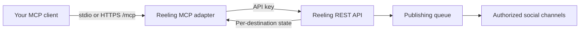

# Reeling MCP server

[](https://github.com/yomariano/reeling-mcp/actions/workflows/test.yml)
[](https://github.com/yomariano/reeling-mcp/releases)
[](LICENSE)

Official open-source **Model Context Protocol (MCP) server for [Reeling](https://reeling.app)**, an AI social media scheduler and short-form video publishing platform.

Use Reeling from Claude Desktop, Cursor, Windsurf, OpenClaw, ChatGPT-compatible connectors, or your own MCP client. The server gives an AI agent a controlled interface for cross-platform social publishing, scheduling, analytics, audience comments, and content adaptation.

This repository is the public developer companion for Reeling. It contains the MCP adapter; runnable API examples live in [reeling-examples](https://github.com/yomariano/reeling-examples); Reeling's private application, production infrastructure, customer data, and credentials are not part of this repository.

**Links:** [Reeling homepage](https://reeling.app) · [Developer portal](https://reeling.app/developers) · [Hosted MCP install](https://mcp.reeling.app/install) · [API settings](https://reeling.app/settings?tab=api) · [Pricing](https://reeling.app/pricing) · [X: @yomariano05](https://x.com/yomariano05)

---

## Platform integrations

Availability depends on the connected account, app access and current capabilities. TikTok inbox delivery requires finishing in TikTok; check the [current platform matrix](https://reeling.app/developers) before publishing.

- 🎵 **TikTok**
- 📸 **Instagram Reels & Stories**
- ▶️ **YouTube Shorts**
- 🦋 **Bluesky**
- 🧵 **Threads**
- 📌 **Pinterest**
- 💼 **LinkedIn**
- 🐦 **Twitter / X**
- 💬 **Discord & Telegram**

---

## 🛠️ Available MCP Tools

| Tool Name | Description |
|---|---|
| `reeling_list_projects` | Lists all projects & workspaces in your Reeling account. |
| `reeling_list_channels` | Lists all connected channels (YouTube, Bluesky, TikTok, Instagram, Threads, Pinterest, etc.) with handle names and account status. |
| `reeling_get_channel_options` | Retrieves publishing options for a connected channel, such as Pinterest boards (ID, name, privacy) or TikTok creator options. |
| `reeling_publish_post` | Publishes or schedules short-form video posts simultaneously to targeted platforms. |
| `reeling_get_post_status` | Checks delivery, processing, and publishing status for a specific post. |
| `reeling_get_analytics` | Fetches aggregated analytics: total views, likes, comments, impressions, and per-platform breakdown. |
| `reeling_sync_metrics` | Triggers a live sync against YouTube, Bluesky, Instagram, Threads, and TikTok APIs. |
| `reeling_get_inbox` | Retrieves audience comments across social channels into a unified inbox. |
| `reeling_reply_to_comment` | Posts a direct reply to a comment on any connected social platform. |
| `reeling_adapt_content_ai` | Uses Reeling's AI copy engine to adapt a hook/script for TikTok, Instagram, YouTube, Threads, or Bluesky. |
| `reeling_generate_video` | Requests short-form video generation through Reeling’s configured service; plan allowance and provider processing apply. |
| `reeling_create_storyboard` | Generates structured multi-scene storyboards (30s up to 5 minutes) broken into consecutive 5s cinematic cuts with audio/foley cues. |
| `reeling_stitch_storyboard` | Requests scene rendering and stitching through Reeling’s configured video workflow. |

---

## 🔑 Getting Started

1. **Obtain your API Key**:
   - Go to [reeling.app](https://reeling.app) and sign in.
   - Navigate to **Settings** → **API Keys**.
   - Generate a new key (starts with `rl_...`).

2. **Run the server**:

   ```bash
   npx -y github:yomariano/reeling-mcp#v1.0.1
   ```

   Or connect to the hosted Streamable HTTP endpoint at `https://mcp.reeling.app/mcp` using the [installation guide](https://mcp.reeling.app/install).

---

## 💻 Configuration Examples

### 1. Claude Desktop
Add this to your `claude_desktop_config.json`:
- **macOS**: `~/Library/Application Support/Claude/claude_desktop_config.json`
- **Windows**: `%APPDATA%\Claude\claude_desktop_config.json`

```json
{
  "mcpServers": {
    "reeling": {
      "command": "npx",
      "args": ["-y", "github:yomariano/reeling-mcp#v1.0.1"],
      "env": {
        "REELING_API_KEY": "rl_your_live_api_key_here",
        "REELING_API_URL": "https://api.reeling.app"
      }
    }
  }
}
```

Or run directly from source:
```json
{
  "mcpServers": {
    "reeling": {
      "command": "node",
      "args": ["/absolute/path/to/reeling-mcp/bin/cli.js"],
      "env": {
        "REELING_API_KEY": "rl_your_live_api_key_here"
      }
    }
  }
}
```

### 2. Cursor IDE
Create or edit `.cursor/mcp.json` in your project root:

```json
{
  "mcpServers": {
    "reeling": {
      "command": "npx",
      "args": ["-y", "github:yomariano/reeling-mcp#v1.0.1"],
      "env": {
        "REELING_API_KEY": "rl_your_live_api_key_here"
      }
    }
  }
}
```

### 3. Antigravity (AGY)
Add to your `~/.gemini/antigravity-cli/mcp_config.json` or project MCP configuration:

```json
{
  "mcpServers": {
    "reeling": {
      "command": "node",
      "args": ["/absolute/path/to/reeling-mcp/bin/cli.js"],
      "env": {
        "REELING_API_KEY": "rl_your_live_api_key_here"
      }
    }
  }
}
```

### 4. Remote Hosted SSE Server (for Grok Bot, Claude Remote, Web Agents)
You can run `reeling-mcp` as a persistent Server-Sent Events (SSE) server for remote AI agents:

```bash
# Run locally or deploy to Railway / Render / VPS / Docker
npx -y github:yomariano/reeling-mcp#v1.0.1 --sse --port 3005
```

Endpoints exposed:
* `GET /health`: Health check status.
* `GET /sse`: Server-Sent Events connection stream (provide a credential through your client’s secret header configuration).
* `POST /messages?sessionId=...`: JSON-RPC protocol message receiver.

#### Grok Bot Configuration (xAI)
Add to your Grok Bot custom MCP servers:
* **Transport**: SSE
* **Endpoint**: `https://mcp.reeling.app/sse` (or `http://localhost:3005/sse`)
* **Headers**: `X-API-Key: rl_your_live_api_key_here`

---

## 🤖 Agent integrations

The hosted server exposes installable bundles and connector metadata for ChatGPT-compatible connectors, Claude, and Grok at [mcp.reeling.app/install](https://mcp.reeling.app/install). The local package works with any MCP client that can launch an npm package or connect to the HTTP transport.

For API-level integrations, see the [Reeling developer portal](https://reeling.app/developers). Please open an issue when you build a client, example, or platform adapter that other Reeling users could reuse.

---

## 🧪 Testing Locally

You can test the MCP server manually using the MCP inspector:

```bash
npx @modelcontextprotocol/inspector node bin/cli.js
```

Or test SSE mode:
```bash
node bin/cli.js --sse --port 3005
curl http://localhost:3005/health
```

---

## 📄 License
MIT © [reeling.app](https://reeling.app)

## Contributing

Issues and pull requests are welcome for client compatibility, documentation, examples, and safe improvements to the MCP transport. Do not commit API keys, production URLs containing secrets, customer data, or private Reeling application code. See the repository's [security policy](SECURITY.md) before reporting a vulnerability.

## Working examples

Clone [reeling-examples](https://github.com/yomariano/reeling-examples) for account discovery, a reviewed video request, bounded delivery-status polling, analytics retrieval and an editable content calendar. Start in offline mode. [Read the example guide](https://reeling.app/developers/examples).

## Architecture



The adapter sends authenticated requests to the Reeling API. Account, plan and platform permissions determine what can run. Review write tools in your client; a tool result or upload receipt alone does not establish public publication.

## Development and releases

```sh
npm ci
npm test
npm run check
npm pack --dry-run
```

See [CONTRIBUTING.md](CONTRIBUTING.md), [CHANGELOG.md](CHANGELOG.md), and [GitHub releases](https://github.com/yomariano/reeling-mcp/releases). Installs above use a versioned GitHub tag; npm publication requires a separate authenticated npm release.
